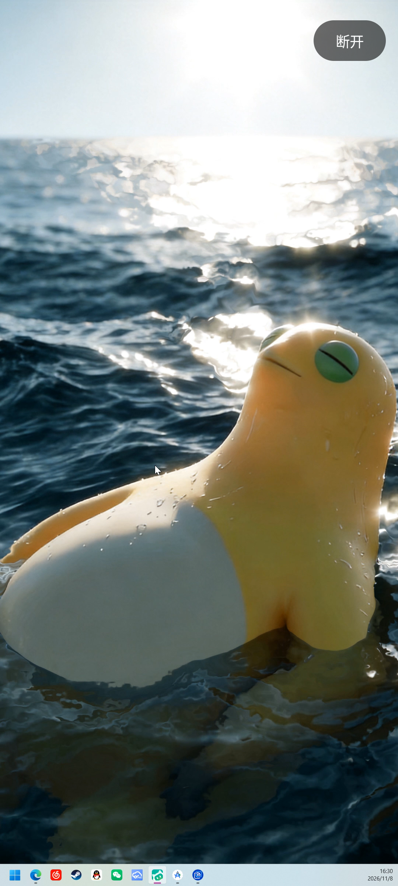
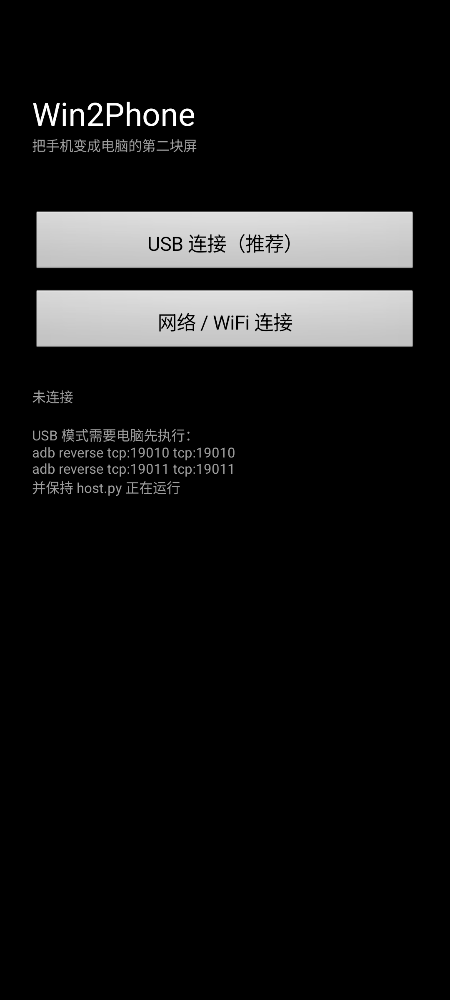

# Win2Phone

把安卓手机变成 Windows 的**第二块显示器**。

不是投屏镜像：Windows 里会真的多出一块屏，窗口可以拖过去，鼠标能从你指定的那条边穿过去，
手机端看到的就是那块屏的完整桌面（有自己的任务栏）。



*手机（1080×2400）显示的就是 Windows 里那块虚拟屏：独立壁纸、独立任务栏、右上角「断开」，
画面里的白色箭头是 PC 端合成进视频帧的鼠标光标。*

## 功能

| 功能 | 说明 |
|---|---|
| 真扩展屏 | 通过虚拟显示器驱动（VDD）在 Windows 中新增一块显示器，可拖窗口、可当主屏 |
| 原生比例 | 虚拟屏按手机屏幕 9:20 定制（1080×2400 / 横屏 2400×1080），1:1 显示，不变形不留黑边 |
| 摆放位置 | 上 / 下 / 左 / 右 四选一，决定鼠标从哪条边穿到手机；修改的是 Windows 显示器实际位置 |
| 横竖屏 | 切换时真的改虚拟屏分辨率并重排位置，手机端自动旋转并重连 |
| 触控回传 | 手机点击 → PC 注入鼠标事件，坐标按虚拟屏物理像素映射 |
| 画面里的光标 | VDD 上系统不绘制光标，由 PC 端合成进视频帧 |
| USB / 局域网 | USB 走 `adb reverse`（不需要 root），WiFi 直接连 IP，两者协议完全相同 |
| 生命周期 | 手机断开时保留虚拟屏（重连即出画）；退出主机时摘除虚拟屏 |

画面链路：`mss 抓屏 → 合成光标 → FFmpeg H.264 → TCP 19010 → 手机 MediaCodec 硬解 → SurfaceView`
控制链路：`TCP 19011`，行分隔 JSON，手机 App 与 PC 面板可同时在线。

## 依赖项

### 电脑端

| 依赖 | 要求 | 用途 |
|---|---|---|
| Windows | 10 / 11 x64 | 显示配置 API（SetDisplayConfig） |
| [Virtual Display Driver](https://github.com/VirtualDrivers/Virtual-Display-Driver) | 25.7.x | 唯一的第三方组件，提供那块虚拟屏 |
| Python | 3.10+ | 运行 `pc/` 下的主机与面板 |
| FFmpeg | 由 `imageio-ffmpeg` 自带 | H.264 编码；N 卡走 NVENC，无 N 卡自动回退 libx264 |
| mss / pywin32 | 见 `pc/requirements.txt` | 抓屏 / Win32 调用 |

### 手机端

| 依赖 | 要求 |
|---|---|
| Android | 8.0（API 26）及以上 |
| 开发者选项 | 打开「USB 调试」并授权本机（USB 模式必需；WiFi 模式不需要） |
| root | 不需要 |

## 目录结构

真正参与运行的文件如下，其余（`.venv/`、`build/`、`.gradle/`、`local.properties`）都在 `.gitignore` 里。

```
win2phone/
├─ start.bat                    一键启动（无控制台窗口，直接开页面）
├─ protocol.md                  视频帧格式与控制消息定义
├─ screenshot.png               手机端实拍（虚拟屏内容）
├─ p1_connect.png               手机端连接界面截图
├─ pc/                          Windows 端
│  ├─ app.py                    控制台：主机 + 网页界面跑在同一个进程里
│  ├─ host.py                   主机：抓屏 → H.264 → TCP、控制通道、虚拟屏生命周期
│  ├─ display.py                虚拟显示器：枚举、接入/摘除、定位、改分辨率
│  ├─ cursor.py                 把鼠标光标合成进视频帧
│  ├─ config.py                 命令行参数
│  ├─ vdd_settings.xml          虚拟显示器的分辨率列表（要装到 C:\VirtualDisplayDriver）
│  ├─ requirements.txt          Python 依赖
│  ├─ selftest.py               不接手机时的视频通道回环自检
│  └─ fetch_wheels.py           可选：pip 装不上时直取 wheel 离线安装
└─ android/                     手机端（Android Studio 工程，纯平台 API，无 AndroidX）
   └─ app/src/main/java/com/example/win2phone/MainActivity.kt
```

## 安装

以下三步只需做一次。

### 1. 装虚拟显示器驱动

```powershell
winget install --id=VirtualDrivers.Virtual-Display-Driver -e --source winget
```

winget 只装「控制端 + 签名驱动包」，**驱动本体要单独装一次**，需要管理员权限。
把下面这段存成 `install-vdd.bat`，**放在工程根目录**（与 `pc\` 同级），右键「以管理员身份运行」：

```bat
set "SRC=%LOCALAPPDATA%\Microsoft\WinGet\Packages\VirtualDrivers.Virtual-Display-Driver_Microsoft.Winget.Source_8wekyb3d8bbwe"
if not exist "C:\VirtualDisplayDriver" mkdir "C:\VirtualDisplayDriver"
copy /Y "%~dp0pc\vdd_settings.xml" "C:\VirtualDisplayDriver\vdd_settings.xml"
"%SRC%\Dependencies\devcon.exe" install "%SRC%\SignedDrivers\x86\VDD\MttVDD.inf" Root\MttVDD
```

装完设备管理器里会出现 `Virtual Display Driver`。`vdd_settings.xml` 定义了 4 个模式：
`1080x2400`、`2400x1080`、`810x1800`、`1800x810`，全部是手机原生 9:20 比例。
**改过这个文件后要重启虚拟屏设备**（管理员：`devcon restart Root\MttVDD`）才生效。

> ⚠️ 更新显卡驱动前先卸载 VDD，否则可能黑屏。

### 2. 装 Python 依赖

```bash
cd pc
python -m venv .venv
.venv/Scripts/python.exe -m pip install -r requirements.txt
.venv/Scripts/python.exe host.py --list      # 应能看到 Virtual Display Driver
```

若 `pip install` 因网络问题失败，可用 `pc/fetch_wheels.py` 直取 wheel 后离线安装。

### 3. 编译手机 APK

用 Android Studio 打开 `android/` 目录直接 Run，或命令行：

```bash
cd android
./gradlew :app:assembleDebug
adb install -r app/build/outputs/apk/debug/app-debug.apk
```

`android/local.properties` 里的 `sdk.dir` 指向本机 SDK，首次打开由 Android Studio 生成。
项目 `compileSdk 35`，若提示缺平台版本，在 SDK Manager 里补装即可。

## 操作

### 启动

双击工程根目录的 **`start.bat`**。只开一个浏览器页面，**没有控制台窗口**：

- 第一次双击 → 后台拉起 `app.py`，等端口就绪后自动打开 <http://127.0.0.1:19012/>
- 已经在跑 → 直接帮你打开页面，不会再起第二份（避免两个主机抢端口）

启动瞬间屏幕会闪一下——Windows 挂上了一块新显示器，正常现象。

需要改参数时用命令行（`python` 而不是 `pythonw`，可以看到实时输出）：

```bash
cd pc
.venv/Scripts/python.exe app.py                        # 30fps / 14M / 竖屏 / 主屏右侧
.venv/Scripts/python.exe app.py --side left            # 摆到左侧
.venv/Scripts/python.exe app.py --landscape 1800x810   # 横屏降一档，省带宽
.venv/Scripts/python.exe app.py --no-browser           # 不自动开浏览器
.venv/Scripts/python.exe app.py --list                 # 只看显示器状态后退出
```

### 页面

所有操作都在同一个页面里，四块可折叠：

| 区块 | 作用 |
|---|---|
| **状态** | 手机是否已连接、虚拟屏设备名、分辨率与坐标、编码器 / 帧率 / 码率 |
| **① 手机摆放位置** | 上 / 左 / 右 / 下，决定鼠标从哪条边穿过去；改的是 Windows 里虚拟屏的实际位置 |
| **② 屏幕方向** | 横屏 / 竖屏，切换会改虚拟屏分辨率，手机自动旋转并重连（约 1 秒中断） |
| **③ USB 连接** | adb 设备状态、端口映射状态，可手动「重建端口映射」 |
| **④ 日志** | 实时日志，等同于原来的控制台输出 |

右上角两个按钮：

| 按钮 | 作用 |
|---|---|
| 重启主机 | 改完参数或画面卡住时用；会保留虚拟屏，不闪屏 |
| 退出 | 停止投屏并**移除虚拟显示器**，困在上面的窗口自动弹回主屏 |

日志同时写一份到 `pc/app.log`，页面打不开时直接看这个文件。

### 连接手机

打开手机上的 **Win2Phone**，按提示选一种方式：

| 方式 | 操作 |
|---|---|
| **USB（推荐）** | 点「USB 连接（推荐）」直接连 `127.0.0.1`，延迟最低、不受 WiFi 干扰 |
| **局域网** | 点「网络 / WiFi 连接」→ 填电脑的局域网 IP → 「开始投屏」（会记住上次输入的地址） |

连上后手机全屏显示那块虚拟屏，右上角只有一个半透明「断开」按钮。返回键同样是断开。



### 停止

点页面右上角「退出」。虚拟屏会从 Windows 里消失。

手机端点「断开」只会停止投屏，虚拟屏保留，下次连上立刻出画——这是刻意的：
反复摘除/挂载虚拟屏会让 Windows 重新枚举显示器，每次都会闪屏。

> 强杀进程（任务管理器结束 `pythonw.exe`）会留下一个看不见的虚拟屏。
> 补救：重新 `start.bat`，再点一次「退出」即可。

## 常见问题

| 现象 | 原因与处理 |
|---|---|
| 页面提示「主机未运行」 | 看「④ 日志」里的报错。最常见是端口被占（提示已有一个主机在跑）或 VDD 没装好 |
| 页面显示 `display_applied: false` | VDD 没装好或虚拟屏没接入桌面。跑 `app.py --list` 确认有 `Virtual Display Driver` 且不是 detached |
| 手机连不上，报 `ConnectException` | 先看「③ USB 连接」里的端口映射状态，点一次「重建端口映射」。仍不行就查 19010 端口是否在监听 |
| 之前能连，过一会儿就连不上 | USB 重新枚举会让 `adb reverse` 失效。控制台空闲时每 5 秒检查并自动重建，也可以手动重建 |
| 启动就报端口占用 | 已经有一个 Win2Phone 在跑（可能是隐藏窗口的 `pythonw.exe`），先退掉它 |
| 手机黑屏但显示「已连接」 | 看 logcat（`adb logcat -s Win2Phone`）里有没有解码器 `configure failed`。多半是分辨率超出硬解能力，用 `--landscape 1800x810` 降一档 |
| 画面比例被拉伸 | 手机没有按虚拟屏的形状旋转。检查虚拟屏尺寸与 App 实际方向是否一致 |
| 画面上没有鼠标箭头 | 确认跑的是本仓库的 `host.py`（光标由 `cursor.py` 合成，系统不会画在 VDD 上） |
| 窗口拖不到手机上 | 鼠标要从主屏的对应边缘一直移过去；在「① 手机摆放位置」把虚拟屏摆到正确的一侧 |

## 已知限制

- 视频通道单客户端，TCP 传输，无鉴权无加密——只在可信局域网或 `adb reverse` 下使用，**不要把 19010/19011 暴露到公网**
- 触控注入的是鼠标事件，不是 Windows 原生多点触控
- 摘除虚拟屏用的是「只保留内置屏」的系统拓扑，**如果接了真实外接显示器，会被一起摘掉**
- 没有音频转发

协议细节（帧格式、控制消息、坐标映射）见 [protocol.md](protocol.md)。
